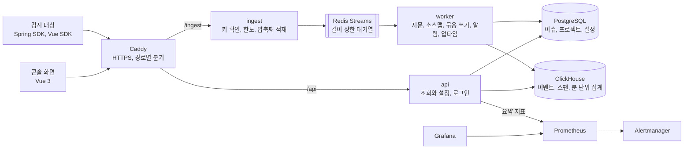

# ErrDeck

여러 서비스의 **에러, 요청 성능, 가동 상태**를 한곳에서 모아 보는 셀프 호스팅 모니터링 플랫폼이다. 감시 대상에 SDK를 붙이면 예외와 요청 추적이 ErrDeck으로 들어오고, 같은 에러는 이슈 하나로 묶여 콘솔 화면에 보인다.

포트폴리오 3번 프로젝트이고, 1번 팬파라이브와 2번 CoPage가 첫 고객이다.

## 무엇을 풀려고 했나

모니터링 서비스는 **감시 대상이 고장 났을 때 가장 많은 요청을 받는다.** 평소에는 조용하다가, 장애가 나는 순간 같은 에러가 초당 수천 건씩 몰려온다. 이때 ErrDeck이 같이 쓰러지면 정작 필요할 때 아무것도 볼 수 없다.

그래서 이 프로젝트의 무게 중심은 화면보다 서버와 인프라 설계에 있다.

- 수집, 처리, 조회를 **부하 성격별로 프로세스 3개**로 나누고, 그 사이를 **길이 상한이 있는 대기열**로 끊었다. 처리가 밀리면 대기열이 상한에서 멈추고 수집은 503으로 정중하게 거절한다.
- 건수는 **전부 정확히** 세고, 원본은 **이슈당 분당 100건까지만** 저장한다. 폭주가 와도 저장량이 터지지 않는다.
- 모든 큐, 스레드 풀, 커넥션 풀, 외부 호출에 **상한과 제한 시간**을 둔다. 메모리 예산은 4코어, 5,632MB 서버 1대 기준이다.
- **ErrDeck이 멈춰도 감시 대상의 요청은 실패하지 않는다.** SDK는 큐와 전송 스레드 하나로 묶어 보내고, 실패하면 버리고 센다.

## 주요 기능

| 영역 | 내용 |
| --- | --- |
| 에러 수집 | 예외와 스택트레이스, 요청 정보, 사용자, 태그, 빵부스러기(직전 동작), 릴리스와 환경 |
| 이슈 | 지문 규칙 9개로 같은 원인의 에러를 묶음. 상태(미해결, 해결, 무시, 재발), 담당자, 최초와 최근 발생, 영향 사용자 수 |
| 소스맵 | 릴리스별로 올린 소스맵으로 브라우저 에러를 원본 파일과 줄로 되돌림 |
| 성능 추적 | 요청 단위 트랜잭션과 스팬, 서비스 사이를 `traceparent` 로 이음. 엔드포인트별 p50, p95, p99, 느린 요청, 반복 쿼리(N+1) 표시 |
| 업타임 | HTTP 점검, 연속 2회로 다운과 복구 판정, 장애 기록, 가동률, 인증서 만료, 내부 주소 차단 |
| 알림 | 새 이슈, 재발, 빈도 초과, 다운, 인증서 만료, 자원 경보를 Slack과 Discord로. 폭주 중에도 재알림 간격에 한 건 |
| 통합 화면 | 시스템별 상태 신호와 프로젝트별 요약 카드(지표 6개). 상세 시계열은 Grafana 링크로 |
| SDK | Spring Boot Starter(서블릿, WebFlux)와 Vue SDK(실행 의존성 없음, gzip 5.4KB) |

## 아키텍처

한 저장소의 코드를 역할이 다른 프로세스 3개(ingest, worker, api)로 띄운다. 셋은 서로 직접 부르지 않고 대기열과 저장소로만 이어진다.



### 프로세스를 셋으로 나눈 이유

도메인이 아니라 **자원을 쓰는 방식**으로 나눴다. 같은 프로세스에 두면 서로를 굶긴다.

| 프로세스 | 하는 일 | 부하 성격 | 멈추면 |
| --- | --- | --- | --- |
| ingest | DSN 키 확인, 크기와 속도 한도, 대기열 적재 | 짧은 I/O가 아주 많음. CPU는 거의 안 씀 | SDK가 버리고 셈. 감시 대상은 영향 없음 |
| worker | 압축 해제, 정규화, 소스맵 복원, 지문, 저장, 알림, 업타임 점검 | CPU를 많이 씀. 묶음 단위 | 대기열에 쌓임. 상한을 넘으면 ingest가 503 |
| api | 콘솔의 조회와 설정, 소스맵 업로드, 로그인 | 건수는 적지만 한 건이 무거운 집계 | 화면만 안 보임. 수집과 저장은 계속 |

에러 폭주로 worker가 CPU를 다 써도 ingest는 응답하고, 누군가 30일 집계를 돌려도 수집은 멈추지 않는다. 컨테이너마다 CPU와 메모리 상한, 스레드 풀, GC를 역할에 맞게 따로 준다.

### 이벤트 한 건이 지나는 길

1. SDK가 이벤트를 모아 압축해 `POST /ingest/{projectId}/envelope` 로 보낸다.
2. ingest가 키와 한도를 확인하고, **본문을 풀지 않은 채** Lua 스크립트 하나로 한도 차감, 대기열 길이 확인, Redis Streams 적재를 한다. 적재에 성공한 뒤에만 202를 준다.
3. worker가 소비 그룹으로 읽어 압축을 풀고 정규화, 소스맵 복원, 지문 계산을 한다.
4. worker가 PostgreSQL에서 지문으로 이슈를 찾거나 만든다(캐시를 거쳐 묶음당 한 번).
5. worker가 ClickHouse에 건수는 전부, 원본은 상한 안에서 묶음으로 쓴다.
6. 쓰기에 성공한 뒤에만 대기열 항목을 확인 처리한다. 중간에 죽으면 다른 worker가 이어받는다.
7. 새 이슈, 재발, 빈도 초과면 알림을 보낸다.

### 저장소를 둘로 나눈 이유

| 저장소 | 담는 것 | 이유 |
| --- | --- | --- |
| ClickHouse | 이벤트, 스팬, 분 단위 집계 | 건수가 많고 한 번 쓰면 안 바뀌며 기간으로 집계해 읽는다 |
| PostgreSQL | 이슈, 프로젝트, 사용자, 알림 규칙, 모니터 | 건수가 적고 상태가 자주 바뀌며 한 건씩 정확히 읽고 쓴다 |
| Redis | 대기열(Streams), 한도 버킷, 처리 표시 | 짧게 살고 빠르게 읽고 쓰는 것 |

결정의 근거와 버린 대안은 [docs/adr/](docs/adr/README.md)의 결정 기록 13개에 있다.

## 실측 결과

목표는 기획서 2.2의 값이고, 결과는 [docs/EXPERIMENTS.md](docs/EXPERIMENTS.md)에 환경과 커밋을 함께 적었다. 아래는 4코어 맥(도커 가상 머신 4코어, 3.9GB)에서 컨테이너 상한을 건 채로 잰 값이다.

| 목표 | 결과 |
| --- | --- |
| 초당 500건을 30분 동안 지연 누적 없이 | 받음 900,000 = 저장 900,000. 대기열 최대 59 봉투 |
| 수집 응답 p99 50ms 이하 | 6.65ms |
| 수신부터 조회 가능까지 p95 5초 이하 | 1.43초 |
| 초당 5,000건 폭주에서 응답하고 건수가 정확함 | 대기열이 상한에서 멈추고 모든 요청에 응답. 30일 조회를 초당 20번 섞어도 수집 p99 14ms |
| 추적을 켠 SDK의 추가 지연 p99 1ms 이하 | SDK를 켠 쪽과 끈 쪽의 차이 0~0.09ms |
| ErrDeck이 멈춰도 감시 대상 요청이 실패하지 않음 | 전체를 내려도 데모 앱 9,000 요청 모두 응답, 제한 시간 0 |
| 장애 실험(worker 강제 종료, ClickHouse 정지 등 6종) | 유실 0, 중복 0 |

## 기술 스택

| 구분 | 사용 |
| --- | --- |
| 백엔드 | Java 25, Spring Boot 4.1, Spring Security 7.1, JdbcClient(JPA 쓰지 않음), Flyway |
| 화면 | Vue 3, Vite, Pinia |
| 저장소 | PostgreSQL 17, ClickHouse, Redis 7(Streams) |
| 관측 | Prometheus, Grafana(대시보드 5개), Alertmanager(경보 규칙 8개) |
| 실행 | Docker Compose(컨테이너마다 CPU와 메모리 상한), Caddy |
| 테스트 | JUnit 5, Testcontainers, Vitest |

## 저장소 구조

```text
ErrDeck/
├── core/          도메인 모델, 지문 규칙, 소스맵 해석, 봉투 형식. 스프링 없는 순수 Java
├── ingest/        수집 프로세스(8080)
├── worker/        처리 프로세스. 웹 서버는 상태 확인과 지표에만(8082)
├── api/           조회와 설정 프로세스(8081). PostgreSQL과 ClickHouse 스키마를 적용한다
├── web/           콘솔 화면(Vue 3)
├── sdk-spring/    Spring Boot Starter SDK
├── sdk-vue/       Vue SDK
├── demo-api/      Starter SDK를 붙인 데모 앱. 예외 경로마다 엔드포인트 하나
├── demo-web/      Vue SDK를 붙인 데모 화면
├── loadgen/       부하와 폭주를 만드는 명령줄 도구
├── deploy/        Caddy, Prometheus, Grafana, Alertmanager, ClickHouse 설정
├── scripts/       초기 데이터, 실험(experiments, chaos), 소스맵 업로드, 백업
└── docs/          기획과 설계 문서, 결정 기록, 실험 결과
```

각 프로세스 안의 패키지는 `domain`, `app`(포트와 서비스), `in`(web, scheduler), `out`(persistence, redis, clickhouse), `config` 로 나눈다. 저장소 접근은 포트 뒤에 둔다.

## 실행하기

### 준비

- JDK 25
- Docker(Docker Desktop 등). 도커 가상 머신에 메모리를 4GB 안팎으로 준다(코어 4개, 3.9GB 에서 전체를 돌렸다)
- 콘솔 화면을 띄우려면 Node.js 22.12 이상([nodejs.org](https://nodejs.org)의 설치 파일)

### 1. 전체를 띄운다

ingest, worker, api는 이미지 안에서 빌드된다. 데모 앱과 loadgen만 먼저 빌드해 둔다.

```bash
./gradlew :demo-api:bootJar :loadgen:installDist
docker compose --profile core --profile obs up -d --build --wait
```

`core` 프로필은 저장소 3개와 ingest, worker, api를, `obs` 프로필은 Prometheus, Grafana, Alertmanager와 수집기를 띄운다. api가 뜰 때 스키마를 적용한다.

### 2. 데모 앱으로 에러를 만든다

데모 프로젝트(ID 9001, 키 `demoapikey`)를 넣고 데모 앱 둘을 띄운다. 프로젝트를 먼저 넣어야 한다. 키가 없을 때 401을 받으면 SDK가 전송을 멈춘다.

```bash
docker compose exec -T postgres psql -U errdeck < scripts/demo/seed.sql
DEMO_ERRDECK_DSN=http://demoapikey@ingest:8080/9001 docker compose --profile demo up -d --build demo-api demo-api-downstream

curl localhost:8090/demo/handled/1     # 500 으로 끝나는 예외. 이슈가 된다
curl localhost:8090/demo/bad-request   # 400. 이슈가 되지 않는다
curl localhost:8090/demo/chain/3       # 데모 앱 둘을 지나는 요청. 추적 화면에서 한 그림으로 보인다
```

데모 앱은 뜨는 데 10초쯤 걸린다.

### 3. 콘솔 화면을 본다

```bash
cd web
npm ci
ERRDECK_API=http://localhost:18081 npm run dev    # http://localhost:5173
```

처음 가입한 사용자가 관리자가 되어 시스템을 만들 수 있다. 데모 앱의 이슈를 보려면 그 사용자를 `데모 앱` 시스템의 구성원으로 넣는다.

```bash
docker compose exec postgres psql -U errdeck -c "insert into system_members (system_id, user_id, role) select s.id, u.id, 'OWNER' from systems s, users u where s.name = '데모 앱' and u.email = '가입한 이메일'"
```

### 4. 내린다

```bash
docker compose --profile core --profile obs --profile demo stop     # 데이터는 볼륨에 남는다
docker compose --profile core --profile obs --profile demo down -v  # 데이터까지 지운다
```

### 주소와 포트

다른 프로젝트와 함께 띄워도 겹치지 않게 호스트 포트를 옮겨 두었다.

| 주소 | 내용 | 바꾸는 환경 변수 |
| --- | --- | --- |
| http://localhost:18080 | ingest | `ERRDECK_INGEST_HOST_PORT` |
| http://localhost:18081 | api | `ERRDECK_API_HOST_PORT` |
| http://localhost:5173 | 콘솔(개발 서버) | |
| http://localhost:13000 | Grafana(익명 보기, 관리자 admin / admin). 대시보드는 ErrDeck 폴더 | `ERRDECK_GRAFANA_PORT` |
| http://localhost:19090 | Prometheus | `ERRDECK_PROMETHEUS_PORT` |
| http://localhost:19093 | Alertmanager | `ERRDECK_ALERTMANAGER_PORT` |
| http://localhost:8090 | 데모 앱 | `DEMO_PORT` |
| localhost:15432, 16379, 18123 | PostgreSQL, Redis, ClickHouse(HTTP). 계정은 모두 `errdeck` / `errdeck` | |

프로세스의 지표(`/actuator/prometheus`)는 컨테이너 안의 관리 포트 8091로만 나오고 호스트에는 열지 않는다.

### 개발할 때: 프로세스를 호스트에서 띄우기

저장소만 compose로 띄우고 프로세스는 Gradle로 띄울 수 있다. 스키마는 api가 적용하므로 api를 먼저 띄운다.

```bash
docker compose up -d                 # 저장소 3개만
./gradlew :api:bootRun               # 8081
./gradlew :ingest:bootRun            # 8080
./gradlew :worker:bootRun            # 8082
```

포트는 `ERRDECK_INGEST_PORT`, `ERRDECK_API_PORT`, `ERRDECK_WORKER_PORT` 로 바꾼다.

### 테스트

```bash
./gradlew build                      # 자바 모듈 전체. Testcontainers 라 도커가 떠 있어야 한다
cd sdk-vue && npm ci && npm test     # Vue SDK
cd web && npm ci && npm test         # 콘솔 화면
```

## 감시 대상에 붙이기

스프링 서비스는 Starter SDK 의존성을 넣고 DSN 하나만 설정하면 500번대로 끝난 예외, 스케줄과 비동기 작업의 예외, `log.error` 의 예외를 잡아 보낸다.

```yaml
errdeck:
  dsn: https://<공개 키>@<ErrDeck 주소>/<프로젝트 ID>
  environment: production
  release: ${GIT_COMMIT}
  tracing:
    sample-rate: 0.1
```

Vue 화면, 지표 수집(Prometheus 에이전트), 소스맵 업로드, 민감한 값 가리기까지 포함한 방법은 [docs/INTEGRATION.md](docs/INTEGRATION.md)에 있다. 소스맵은 빌드 뒤에 프로젝트 토큰으로 올린다.

```bash
ERRDECK_TOKEN=edt_... scripts/upload-sourcemaps.sh http://localhost:18081 9002 demo-web@1a2b3c4 demo-web/dist
```

## 실험 다시 돌리기

부하, 자원, 장애 실험은 스크립트로 다시 돌릴 수 있다. 실험 프로젝트를 먼저 넣는다.

```bash
docker compose exec -T postgres psql -U errdeck < scripts/experiments/seed.sql
python3 scripts/experiments/load.py sustained          # 지속 부하. diversity, interference, sdk-overhead
python3 scripts/experiments/resources.py gc            # 자원 실험 7종. 이름은 스크립트 첫머리에
python3 scripts/chaos/chaos.py worker-kill             # 장애 실험 6종
scripts/chaos/redis-recreate.sh                        # Redis 를 새 주소로 다시 만들기
```

도커 가상 머신의 코어가 10개보다 적으면 `ERRDECK_STACK_CPUS=0-3 ERRDECK_LOADGEN_CPUS=0-3` 을 함께 준다. 노트북이면 `caffeinate -i` 로 잠자기를 막는다. 잠자기에 들면 도커와 부하 도구가 함께 멈춰 결과가 무효가 된다.

## 문서

| 문서 | 내용 |
| --- | --- |
| [docs/README.md](docs/README.md) | 기획과 설계 문서 20장의 목차와 읽는 순서 |
| [docs/01-PLAN.md](docs/01-PLAN.md) | 기획서. 목표, 범위, 비기능 목표 |
| [docs/02-ARCHITECTURE.md](docs/02-ARCHITECTURE.md) | 프로세스 구성, 이벤트가 지나는 길, 버린 대안 |
| [docs/12-RESOURCES.md](docs/12-RESOURCES.md) | CPU 배분, 스레드 모델, 역압, 메모리 예산, 제한 시간 |
| [docs/adr/](docs/adr/README.md) | 결정 기록 13개 |
| [docs/EXPERIMENTS.md](docs/EXPERIMENTS.md) | 부하, 자원, 장애 실험의 실측값 |
| [docs/INTEGRATION.md](docs/INTEGRATION.md) | 감시 대상에 SDK와 지표 수집을 붙이는 방법 |
| [docs/DEPLOY-OCI.md](docs/DEPLOY-OCI.md) | 오라클 무료 서버 배포 절차 |
| [docs/CHOICES.md](docs/CHOICES.md) | 작업 중에 추천안으로 정한 것과 이유. 나중에 검토할 목록 |
| [docs/WORKFLOW.md](docs/WORKFLOW.md) | 작업 절차, 작업 목록, 진행 체크 |

## 진행 상황

작업 26개 중 24개를 마쳤다. 팬파라이브와 CoPage는 같은 맥에서 SDK를 붙여 에러, 추적, 요약 카드가 통합 화면에 보이는 것까지 확인했다. 남은 것은 오라클 서버 배포(25, 설정과 절차는 준비됨)와 2코어에서의 재측정이다. 로컬 쿠버네티스(26)는 하지 않기로 했다. 자세한 체크는 [docs/WORKFLOW.md](docs/WORKFLOW.md)의 5장에 있다.

## 작업 방식

- 작업 하나는 이슈 하나, 브랜치 하나, PR 하나다.
- 브랜치는 develop에서 `feature/NN-이름` 으로 만들고, PR은 develop으로 보내며 본문에 `Closes #이슈번호` 를 적는다.
- develop과 main에 직접 푸시하지 않는다.
