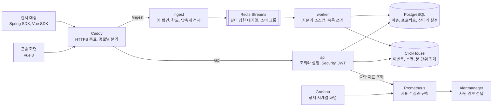

# 4. 서비스 아키텍처

한 저장소의 코드를 역할이 다른 프로세스 3개(ingest, worker, api)로 띄우고, 그 사이를 길이 상한이 있는 대기열로 끊는다.

이벤트는 감시 대상에서 ingest, 대기열, worker를 거쳐 저장소로 들어가고, 사람은 콘솔 화면에서 api를 거쳐 저장소를 읽는다. 두 길은 저장소에서만 만난다. Prometheus, Grafana, Alertmanager는 이 모든 것을 바깥에서 지켜보는 관측 도구다.

## 4.1 프로세스 구성

| 프로세스 | 하는 일 | 부하 성격 | 멈추면 생기는 일 |
| --- | --- | --- | --- |
| ingest | DSN 키 확인, 크기와 속도 한도 검사, 대기열 적재 | 짧은 I/O가 아주 많음. CPU는 거의 안 씀 | SDK가 잠시 모았다가 버림. 감시 대상은 영향 없음 |
| worker | 압축 해제, 정규화, 소스맵 복원, 지문 계산, 저장, 알림 판정, 업타임 점검 | CPU를 많이 씀. 묶음 단위로 움직임 | 대기열에 쌓임. 상한을 넘으면 ingest가 거절 응답을 보냄 |
| api | 콘솔 화면의 조회와 설정, 소스맵 업로드, 로그인 | 건수는 적지만 한 건이 무거운 집계 쿼리 | 화면만 안 보임. 수집과 저장은 계속됨 |
| web | Vue 3 정적 파일. Caddy가 직접 내려 줌 | 없음 | 화면만 안 보임 |

## 4.2 셋으로 나누는 이유

세 역할은 자원을 쓰는 방식이 다르고, 서로를 굶길 수 있다.

- 에러 폭주가 오면 worker는 CPU를 전부 쓴다. 같은 프로세스에 수집 엔드포인트가 있으면 응답이 느려지고, SDK의 재시도가 겹쳐 더 나빠진다.
- 누군가 화면에서 30일 치 집계를 돌리면 api의 힙과 스레드가 묶인다. 같은 프로세스라면 그 순간 수집이 멈춘다.
- 프로세스를 나누면 컨테이너마다 CPU와 메모리 상한을 따로 줄 수 있다. 스레드 풀과 GC 설정도 역할에 맞게 다르게 잡는다. 구체적인 값은 14장에 적는다.

도메인 기준이 아니라 부하 성격 기준으로 나눈 것이 팬파라이브(도메인별 MSA)와 다른 점이다. 세 프로세스는 같은 도메인 코드를 공유하고, 서로 직접 호출하지 않는다. 대기열과 저장소를 통해서만 이어진다.

## 4.3 이벤트 한 건이 지나는 길

1. SDK가 이벤트를 모아 압축해서 `POST /ingest/{projectId}/envelope` 로 보낸다.
2. Caddy가 HTTPS를 끝내고 `/ingest/*` 는 ingest로, `/api/*` 는 api로 넘긴다.
3. ingest가 DSN 키와 한도를 확인하고, 본문을 풀지 않은 채로 Redis Streams에 넣는다. 넣는 데 성공한 뒤에만 202를 응답한다.
4. worker가 소비 그룹으로 읽어 압축을 풀고 정규화, 소스맵 복원, 지문 계산을 한다.
5. worker가 PostgreSQL에서 지문으로 이슈를 찾거나 만든다.
6. worker가 이벤트를 모아 ClickHouse에 묶음으로 쓴다.
7. 묶음 쓰기가 성공한 뒤에만 대기열 항목을 확인 처리(XACK)한다. 중간에 죽으면 다른 worker가 이어받는다.
8. 새 이슈, 재발, 빈도 초과면 알림 대기열에 넣는다.

## 4.4 코드 구조

Gradle 멀티 모듈 한 저장소로 관리한다.

| 모듈 | 내용 |
| --- | --- |
| core | 도메인 모델, 지문 계산, 소스맵 해석, 봉투 형식. 스프링에 의존하지 않는 순수 Java |
| ingest | 수집 프로세스. Spring MVC |
| worker | 처리 프로세스. 웹 서버 없이 관리 포트만 연다 |
| api | 조회와 설정 프로세스. Spring MVC, Spring Security |
| sdk-spring | Spring Boot Starter SDK. 감시 대상이 의존성으로 추가한다 |
| sdk-vue | Vue SDK. npm 패키지 |
| web | 콘솔 화면. Vue 3, Vite, Pinia |
| loadgen | 부하와 폭주를 만드는 도구 |

core를 순수 Java로 두는 이유는 CoPage의 ot-core와 같다. 지문 규칙과 소스맵 해석은 이 서비스에서 가장 틀리기 쉬운 부분이라, 스프링 없이 빠르게 대량 테스트를 돌릴 수 있어야 한다.

## 4.5 버린 대안

| 대안 | 버린 이유 |
| --- | --- |
| 프로세스 하나에 전부 | 4.2의 굶김 문제. 역할별 자원 상한을 줄 수 없음 |
| 도메인별 MSA(프로젝트 서비스, 이슈 서비스, 알림 서비스) | 이 서비스의 병목은 도메인 경계가 아니라 수집과 처리의 부하 차이에 있음. 서비스 간 호출만 늘어남 |
| 대기열로 Kafka | 서버 1대에서 브로커 하나에 메모리 1GB 안팎이 든다. 이미 쓰는 Redis로 충분한 처리량이라고 판단. 18장 실험에서 한계가 확인되면 다시 검토 |
| 대기열로 PostgreSQL 테이블 | 폭주 때 삽입과 삭제가 몰려 죽은 행과 WAL이 빠르게 늘어남. 이슈 조회와 같은 DB를 건드리게 됨 |
| ingest가 ClickHouse에 바로 쓰기 | 소스맵 복원과 지문 계산이 저장 전에 끝나야 함. ClickHouse가 느려지면 수집 응답도 느려짐 |
| ingest를 WebFlux로 | Java 25의 가상 스레드로 같은 동시성을 블로킹 코드로 얻을 수 있음. 팀 전체 코드를 한 방식으로 유지 |
